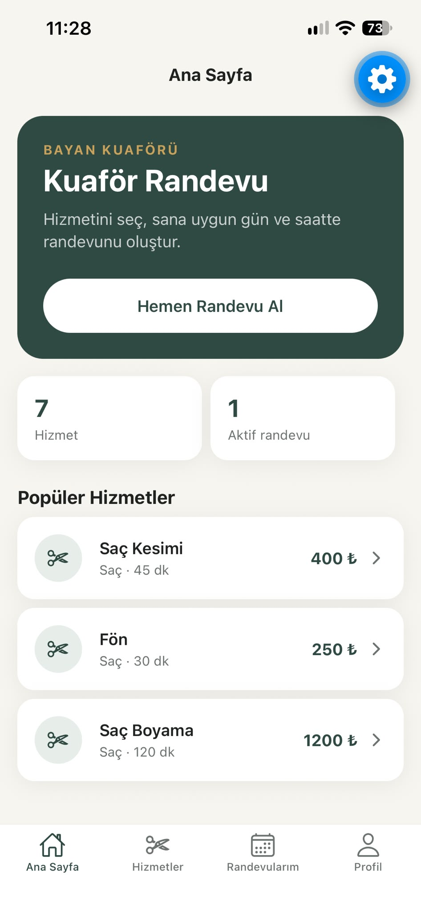
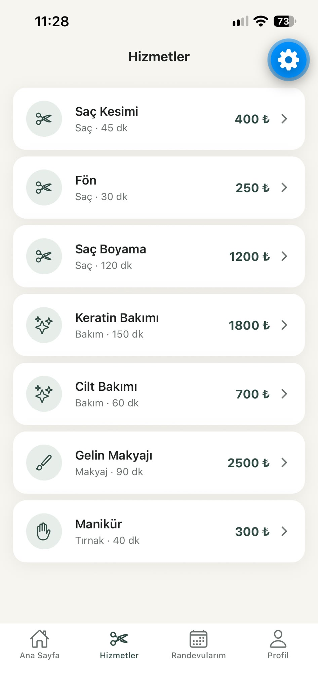
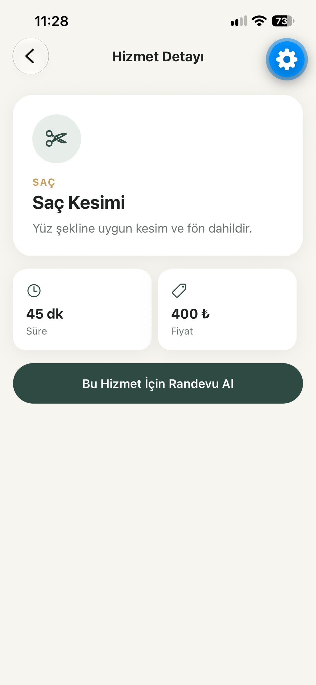
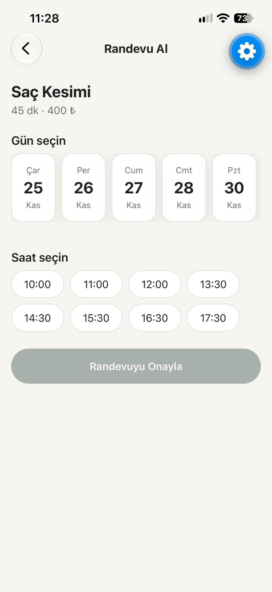
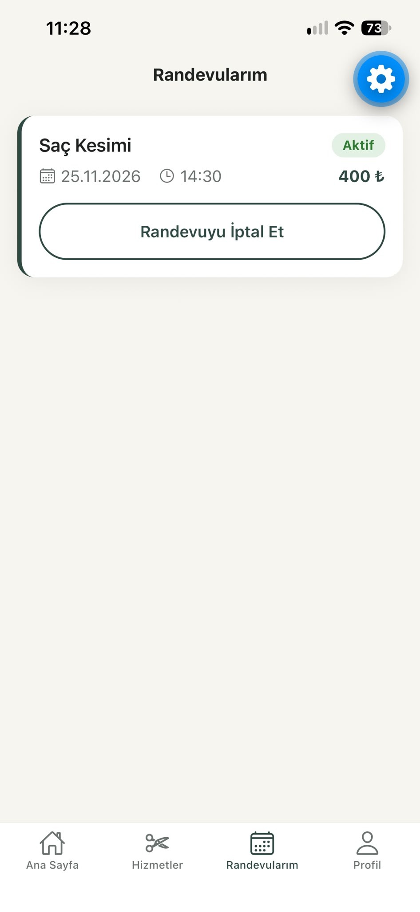

# Bayan Kuaförü Randevu Sistemi

**Öğrenci:** Enes Çelik – 250408032
**Ders:** BGP 201 Mobil Programlama – Dönem Projesi
**Kategori:** Hizmet ve Randevu

## Uygulamanın amacı
Bayan kuaförü müşterilerinin hizmetleri görüntüleyip gün/saat seçerek randevu almasını,
randevularını görmesini ve iptal etmesini sağlayan React Native mobil uygulaması.

## Özellik listesi
- [x] Hafta 4–5: 6 ekran, ortak tema dosyası (`src/constants/theme.ts`)
- [x] Hafta 6: `useState` + `useContext` ile paylaşılan randevu verisi
- [x] Hafta 7: Stack + Bottom Tab navigasyonu
- [x] Hafta 9: Randevu formu ve doğrulama
- [ ] Hafta 10: Resmi tatil API'si (kapalı günler)
- [ ] Hafta 11: FlatList + arama/filtreleme
- [ ] Hafta 12: Firebase Authentication + Firestore (ekle/listele/güncelle/sil)
- [ ] Hafta 13: Hata/yükleniyor/boş liste durumları, (bonus) fotoğraf

## Kullanılan kütüphaneler ve API'ler
React Native (Expo), TypeScript, React Navigation (native-stack, bottom-tabs),
react-native-screens, react-native-safe-area-context, @expo/vector-icons.

## Kurulum ve çalıştırma
```bash
npm install
npx expo start
```
Telefonda Expo Go ile QR kodu okutun veya Android emülatöründe `a` tuşuna basın.

## Yapay zekâ kullanım beyanı

Bu projeyi geliştirirken yardımcı araç olarak Claude (Anthropic) kullandım.
Claude'dan proje iskeletini, ekranların ve bileşenlerin kodlarını ve
tasarım düzenlemelerini hazırlamasını, ayrıca Git ve Expo kullanırken
karşılaştığım hatalarda yönlendirme yapmasını istedim.

Konuyu seçmek, kodu projeye eklemek, uygulamayı telefonda denemek, tasarım
kararlarını vermek ve GitHub'a yüklemek bana aittir. Her hafta eklenen yeni
özelliklerde de aynı yöntemi izleyeceğim ve bu beyanı güncel tutacağım.

## Ekran görüntüleri ve açıklamaları

| Ekran | Açıklama |
|:---:|:---|
|  | **Ana Sayfa**<br>Uygulamanın karşılama ekranıdır. Üstteki koyu kartta salonun tanıtımı ve "Hemen Randevu Al" butonu vardır; butona basınca Hizmetler ekranına geçilir. Altındaki iki kutu toplam hizmet sayısını ve kullanıcının aktif randevu sayısını gösterir. En altta popüler hizmetlerden üçü listelenir, dokununca hizmet detayı açılır. |
|  | **Hizmetler**<br>Salonun sunduğu bütün hizmetler listelenir. Her kartta kategori ikonu, hizmet adı, süresi ve fiyatı bulunur. Bir karta dokununca o hizmetin detay ekranı açılır. |
|  | **Hizmet Detayı**<br>Seçilen hizmetin kategorisi, adı, açıklaması, süresi ve fiyatı gösterilir. Alttaki "Bu Hizmet İçin Randevu Al" butonu randevu ekranına götürür. |
|  | **Randevu Al**<br>Kullanıcı önce yatay kaydırmalı kartlardan gün, sonra saat seçer. Gün ve saat seçilmeden "Randevuyu Onayla" butonu pasif kalır. Onaylayınca randevu kaydedilir ve Randevularım ekranına geçilir. |
|  | **Randevularım**<br>Alınan randevular kart olarak listelenir. Her kartta hizmet adı, tarih, saat ve fiyat ile "Aktif" veya "İptal" durum etiketi görünür. Aktif randevu "Randevuyu İptal Et" butonuyla iptal edilebilir. Hiç randevu yoksa bilgilendirme mesajı gösterilir. |
